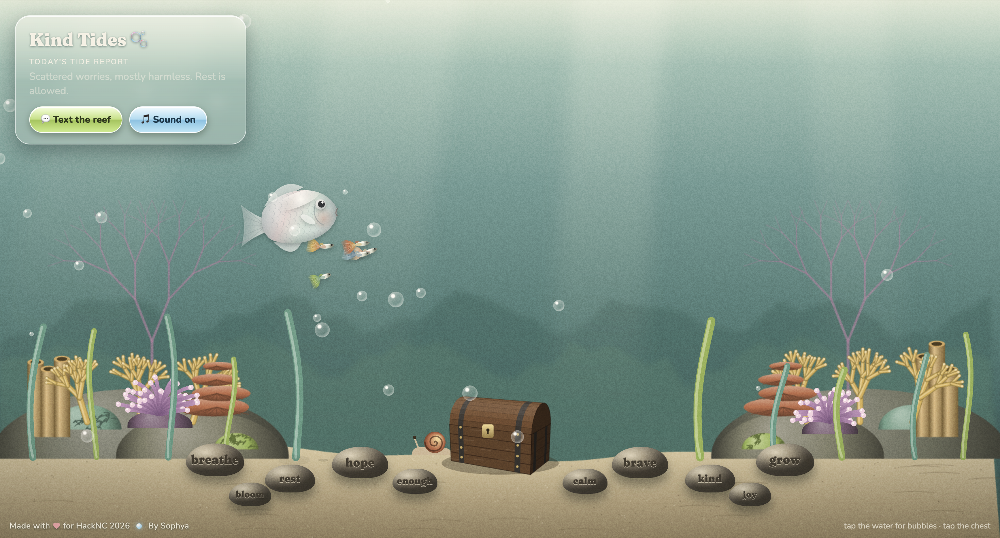

<div align="center">

# 🫧 Kind Tides 🫧

### *a gentle reef you can text on rough days*




**🌊 [Visit the reef at kindtides.tech](https://kindtides.tech) 🌊**

</div>

---

## 🐚 Today's tide report

> *"The currents get heavy sometimes, but the tide always turns.
> Open a window and let some cool air drift in."* 🌊
> — the reef, replying to "rough day today"

Kind Tides is an **iMessage agent** you can text when you're stressed, stuck, or just tired.
It texts back a short, warm "tide report" with one tiny nudge to reconnect with nature:
open a window, look at the sky, refill a water bottle instead of buying one.

Every message also opens a **treasure chest** in the **Reef View**, a living underwater world
where a pearly parrot fish swims with its little guppies, anemones sway, and stones on the sand
whisper *breathe · rest · hope · enough · calm · brave · kind · grow · bloom · joy*.

---

## 🐠 Try it out

| | How | Setup needed |
|---|---|---|
| 🪸 **Visit the reef** | Open [kindtides.tech](https://kindtides.tech), tap 🎵 **Sound on**, tap the water for bubbles, tap the chest | none ✨ |
| 💬 **Chat in your terminal** | `npm install`, then `npm run test-chat` | none, no keys needed |
| 📱 **Run your own iMessage reef** | Add your own keys (below), then `npm start` | Photon + Gemini keys |

---

## 🌿 How it works

```
📱 you text the reef
   ↓  Photon Spectrum (real iMessage line, with typing bubbles)
🐚 agent.mjs remembers your last few messages
   ↓  Google Gemini, guided by a gentle "reef" personality
🌊 a kind tide report texts back to you
   ↓
🪙 the treasure chest opens on the reef and your message floats up
```

- 💙 **Safety first:** if someone mentions self-harm, the reef skips the AI and replies with care, pointing to the **988 Suicide & Crisis Lifeline**.
- 🫧 **Always answers:** if Gemini is unavailable, the reef replies with a pre-written kind message.
- 🔒 **Private:** phone numbers are never shown on the reef.

---

## 🎨 Made with

- **Photon Spectrum**: the iMessage line
- **Google Gemini**: writes every reply
- **Node.js**: runs the agent and streams messages to the reef
- **HTML5 Canvas**: 3D-shaded fish with natural swimming, plus a treasure chest drawn with real 3D projection so the lid swings on its hinge
- **Web Audio API**: original music composed live in the browser (soft chords, marimba plinks, bubble pops, a chest chime). No recordings, no copyright.
- **Frutiger Aero × 70s film**: glossy glass and bubbles over a faded retro palette with grain
- **Netlify** + **kindtides.tech**

---

## 🛠️ Run your own reef (Mac / Linux)

1. Install **Node.js** (LTS) from [nodejs.org](https://nodejs.org)
2. `npm install`
3. Copy `.env.example` to `.env` and add **your own** keys:
   - `SPECTRUM_PROJECT_ID`, `SPECTRUM_PROJECT_SECRET`: from [app.photon.codes](https://app.photon.codes) (create a project, then add your phone number under **Users**)
   - `GEMINI_API_KEY`: from [aistudio.google.com](https://aistudio.google.com)
   - `GEMINI_MODEL` *(optional)*: defaults to `gemini-3.8-flash`
4. `npm start`, open http://localhost:3000, and text your Photon line 🫧

> 🔒 API keys are never stored in this repository. `.env` is listed in `.gitignore`.

---

<div align="center">

Made with 💗 for **HackNC 2026** · 🔵 by **Sophya**

*clear skies, clean code, kind tides* 🫧

</div>
